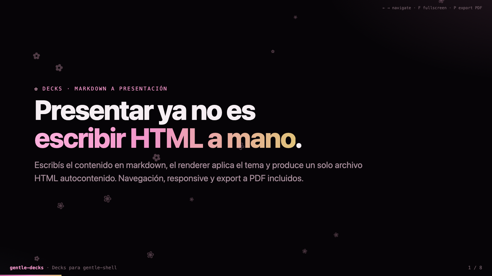
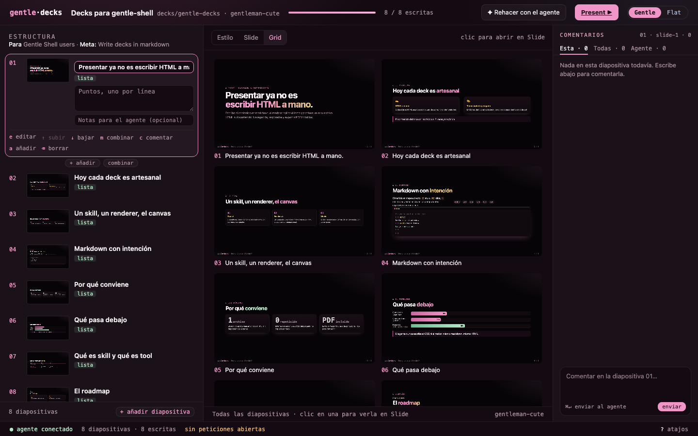
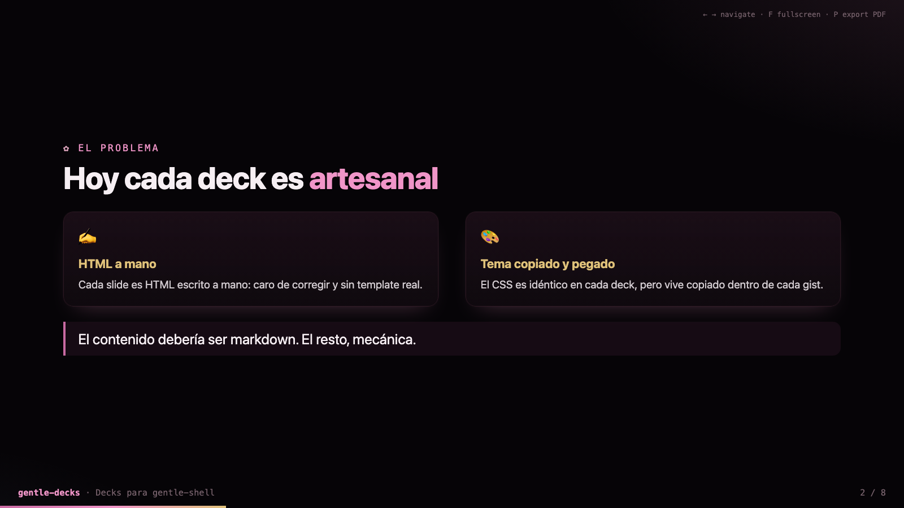

# gentle-decks

**Ask your agent for a presentation. Get one HTML file you can present anywhere.**

gentle-decks is a [Gentle Shell](https://github.com/Gentleman-Programming/gentle-shell)
and [Pi](https://pi.dev) package. The agent writes the slides in markdown; the
renderer handles layout, theme and navigation, and produces one self-contained
HTML file with no external requests.

<a href="https://github.com/Gentleman-Programming/gentle-ai">
  
</a>



## Quick start

```bash
# Gentle Shell
gentle-shell install git:github.com/WilberC/gentle-decks

# Pi
pi install git:github.com/WilberC/gentle-decks
```

Restart the session (or `/reload`) and ask: *"Make a presentation about …"*.
Requires Node.js 18 or later.

## What you get

| | |
| --- | --- |
| **Guided flow** | The agent asks about audience, goal and length, proposes an outline, then writes slide by slide. |
| **Studio** | A local web app to edit the outline, pick a theme, and comment on slides while the agent writes. |
| **One file out** | Theme CSS and navigation are inlined. Arrows or swipe to navigate, `F` fullscreen, `P` to export to PDF. |
| **Small diffs** | The same markdown always renders byte-identical HTML, so a fix is an edit to one slide. |
| **Themes** | `gentleman-cute`, `fair-test` and `fair-test-gentle`, or have the agent propose a new one for your topic. |





## Learn more

| I want to… | Read |
| --- | --- |
| Write or fix slides by hand | [FORMAT.md](FORMAT.md) |
| Use the studio | [docs/studio.md](docs/studio.md) |
| Run the CLI directly | [docs/cli.md](docs/cli.md) |
| Make a theme | [themes/CONTRACT.md](themes/CONTRACT.md) |
| See what the agent does | [skill/gentle-decks/SKILL.md](skill/gentle-decks/SKILL.md) |
| Contribute or run the checks | [docs/development.md](docs/development.md) |

The canvas preview uses Gentle Shell's `gentle_design` tool; in plain Pi the
renderer and the studio work the same.

## License

MIT. See [LICENSE](LICENSE).
