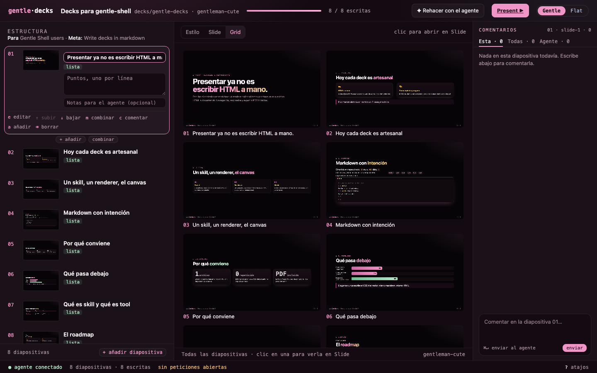

# Studio

The studio is a local web app for building a deck with the agent: you edit the
outline and comment on slides, and the agent writes the slides.



## Start it

```bash
node bin/decks.js studio decks/<slug>    # needs decks/<slug>/plan.json
npm run studio:demo                      # eight-slide demo plan in decks/demo/
```

It prints `studio: http://127.0.0.1:<port>/<token>/`. The studio listens only on
127.0.0.1, and the URL carries a random token created at each start.

## Layout

| Area | What you do there |
| --- | --- |
| **Outline** (left, always visible) | See every slide with its thumbnail, status (`pendiente`, `escribiendo…`, `lista`, `no cabe`) and open comments. Edit text, add, merge, move, delete, or comment in place. |
| **Center** | **Estilo**: theme previews rendered with your outline, **✦ Proponer estilo**, and Generate; click a style to open its detail (big preview, component examples, choose / comment / improve). **Slide**: the selected slide with Ver / Comentar / Editar modes, a layout switch and an overflow warning. **Grid**: every slide, filling in live as the agent writes. |
| **Comments** (right) | One thread per slide. The agent answers in the same thread. |

Keyboard shortcuts on the focused outline row: `e` edit, `↑↓` select,
`Alt+↑↓` move, `m` merge, `c` comment, `a` add, `Delete` remove.

## Skins and URLs

- Two skins: **Gentle** (default, the Gentle brand palette) and **Flat** (the
  Gentle Shell terminal palette). Switch in the header; the choice is
  remembered. `?skin=flat` forces it.
- Append `#style`, `#slide`, or `#grid` to open a view (`#plan` and `#editor`
  still work).

## How the agent sees your actions

The studio writes `plan.json` and text edits directly. Everything that needs
writing (generate, comments, redo, layout, new slides, overflow, style proposals)
is queued in `requests.json` and printed as `request <id> <kind> <slide>`. The agent handles
each one and answers with `studio reply` or `studio resolve --reply`; see
[cli.md](cli.md) for the commands and the
[skill](../skill/gentle-decks/SKILL.md) for what the agent does per request.

| Kind | Fields | What the agent does |
| --- | --- | --- |
| `generate` | — | Writes the pending slides in plan order. |
| `comment` | `slideId`, `text`, `selector`, `excerpt` | Applies the comment to that slide. |
| `redo` | `slideId`, `text` | Rewrites the slide, keeping its id. |
| `layout` | `slideId`, `layout` | Rewrites the slide with another container. |
| `add-slide` | `slideId`, `text` | Adds a slide after that one, in the plan and the deck. |
| `overflow` | `slideId` | Shortens or splits a slide that does not fit 1600×900. |
| `propose-style` | `mode` (`new`, `improve`, `comment`), `theme`, `text` | Writes `decks/<slug>/themes/<name>.css`: a new theme, an improvement of `theme`, or the answer to your comment about `theme`. |

## Themes

Bundled themes: `gentleman-cute`, `fair-test` (bright, white, rainbow method
stages) and `fair-test-gentle` (the same structure in Gentle colors). A deck
can ship its own in `decks/<slug>/themes/` (shown as *propuesto*), and your own
themes in `~/.config/gentle-decks/themes/` appear in every deck (shown as *mío*);
see [themes.md](themes.md) for where themes live and the lookup order. Themes must follow
[themes/CONTRACT.md](../themes/CONTRACT.md).

**Proponer estilo**: the button next to the theme cards asks the agent for a new
theme for this deck; the optional instructions describe the look you want. The
result appears as *propuesto* as soon as the agent writes the CSS.

**Theme detail**: clicking a card opens the style on its own stage with the first
slides rendered in it, the components the theme contract requires (`card`, `step`,
`bars`, `stat`, `term`, `pills`, `figure`) as a plain legend, and three actions:
**Elegir este estilo** sets `plan.theme`; **Comentar este estilo** and
**Mejorar este estilo** queue a `propose-style` request for that theme, so the
agent edits its CSS instead of a slide. **← Volver a los estilos** returns to the
cards.
